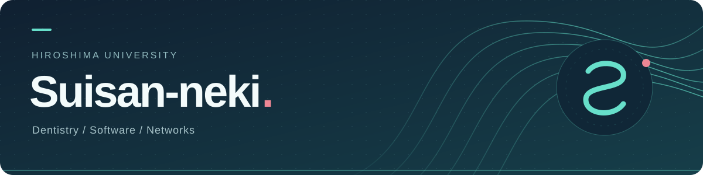

 

広島大学 歯学部歯学科3年。医療とソフトウェア、ネットワークに関心があります。

 

 

<table>
<tr>
<td width="50%" valign="top">
<h3>いま作っているもの</h3>
<a href="https://github.com/Suisan-neki/execution-evidence-lab"><b>execution-evidence-lab ↗</b></a>

ソフトウェアの構成や動作を確認し、試した結果を記録・比較する検証基盤を開発しています。

Rust · ソフトウェア検証 · 医療
</td>
<td width="50%" valign="top">
<h3>関心のあること</h3>

医療分野のソフトウェア

<a href="https://qiita.com/Suisan-neki/items/cafab8fd958a80ab10ee">Rust × Raspberry Piで試したこと ↗</a>
</td>
</tr>
</table>

### 最近聴いている音楽

<a href="https://www.last.fm/user/suisan_2003">
  <picture>
    <source media="(prefers-color-scheme: dark)" srcset="https://lastfm-recently-played.jeffreyca.workers.dev/svg?user=suisan_2003&amp;count=3&amp;width=800&amp;theme=dark&amp;bg_color=101f2e&amp;accent_color=63dbc5&amp;profile=off&amp;radius=14">
    
  </picture>
</a>

### 最近書いた記事

<!-- QIITA:START -->
<ul>
<li><a href="https://qiita.com/Suisan-neki/items/cafab8fd958a80ab10ee">Rust + Raspberry Piでネットワークの低レイヤを触る(+技育博vol.2の反省)</a> 2026-09-23</li>
<li><a href="https://qiita.com/Suisan-neki/items/a51ee3df39d8edcd18f7">無停止デプロイ（ゼロダウンタイムデプロイ）とDB互換性について考える</a> 2026-09-17</li>
<li><a href="https://qiita.com/Suisan-neki/items/dd8eeb97ba75f05b568f">STORES Tech Conf 2026 “World 2” に参加しました</a> 2026-09-10</li>
</ul>
<!-- QIITA:END -->

<a href="https://qiita.com/Suisan-neki">記事をもっと読む ↗</a>

### GitHubでの活動

<picture>
  <source media="(prefers-color-scheme: dark)" srcset="https://github-profile-summary-cards.vercel.app/api/cards/profile-details?username=Suisan-neki&amp;theme=github_dark">
  
</picture>

 

美人は3日で飽きる

